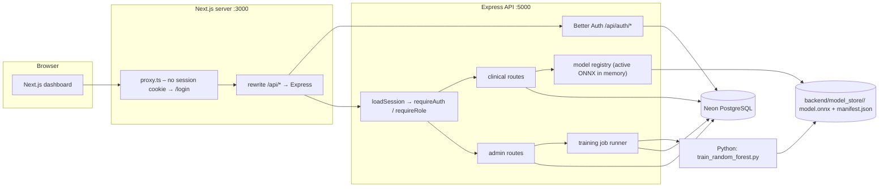
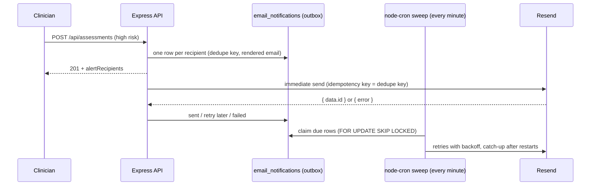

# CVD Prediction System – Saint Mary's Hospital, Drobo

## System documentation: architecture, model, security, operations

> **Status (2026-11-19):** implemented end to end – Random Forest pipeline, Express API with
> authentication and role-based access, PostgreSQL (Neon) via Drizzle ORM, and the Next.js dashboard.
> The project brief (Chapters 1–2) is in [AGENTS.md](../AGENTS.md). §12 lists what is still open.

---

## Contents

1. [Summary](#1-summary)
2. [Requirements traceability (Chapter 1 objectives)](#2-requirements-traceability-chapter-1-objectives)
3. [Architecture](#3-architecture)
4. [Data and model](#4-data-and-model)
5. [Authentication, access control and data protection](#5-authentication-access-control-and-data-protection)
6. [Database schema](#6-database-schema)
7. [API reference](#7-api-reference)
8. [User interface](#8-user-interface)
9. [Running the system](#9-running-the-system)
10. [Testing and verification](#10-testing-and-verification)
11. [Operations runbook](#11-operations-runbook)
    - [11a. Automated high-risk email alerts](#11a-automated-high-risk-email-alerts)
12. [Limitations and open items](#12-limitations-and-open-items)
13. [Decisions log](#13-decisions-log)

---

## 1. Summary

A web application that lets **authorised hospital staff** enter a patient's clinical measurements and get a
**Random Forest** estimate of the probability of cardiovascular disease (CVD), shown as decision support,
never as a diagnosis.

| Layer | Technology |
|---|---|
| Model training | Python 3.10+, scikit-learn, skl2onnx, onnxruntime |
| Inference | ONNX model in Node.js (`onnxruntime-node`) – no Python at request time |
| API | Node.js 22+, Express 5, Better Auth, zod, helmet |
| Database | PostgreSQL on Neon, Drizzle ORM + drizzle-kit migrations |
| Web app | Next.js 16 (App Router), React 19, Tailwind 4, shadcn/ui, TanStack Query, Recharts |
| Notifications | Resend (email), node-cron (background jobs), transactional outbox table |

**Removed** compared with the original prototype: the MongoDB layer, the CNN/CNN-LSTM models, the
"federated learning" tab, the multi-model clinical endpoints, and the Google Gemini integration
(it sent patient data to a third party). Git history keeps all of it.

---

## 2. Requirements traceability (Chapter 1 objectives)

| Objective | How the system meets it | Evidence for Chapter 4 |
|---|---|---|
| (a) Authorised users enter patient data and obtain predictions | Login → *New assessment* form generated from the model's feature spec → result page; every assessment stored against patient, user and model version | Screens in §8; functional tests in §10 |
| (b) Train and integrate a Random Forest | [train_random_forest.py](../model_training/train_random_forest.py) → ONNX + manifest → loaded by [registry.js](../backend/src/ml/registry.js) | Training log; parity test (Python = Node to 1e-5) |
| (c) Evaluate with accuracy, precision, recall, F1, confusion matrix | Manifest stores those plus specificity, ROC-AUC, Brier score, ROC curve, calibration curve, CV mean ± SD, and baselines; shown on **Model performance** | §4.4; `/model` page |
| (d) Authentication, access control, data protection | Better Auth (hashed passwords, DB sessions, rate limiting), roles admin/clinician enforced in the API, forced password change, account disabling, audit log, data minimisation (no names), security headers | §5; RBAC tests |
| (e) Functionality and usability testing | Automated tests (13), API end-to-end checks, browser screenshots; SUS study still to be run with staff | §10, §12 |

---

## 3. Architecture



Design principles:

1. **One backend.** Express owns authentication, authorisation, validation, inference and all DB access.
   Next.js only renders UI and proxies `/api/*`, so the browser sees one origin, the session cookie
   is first-party, and no CORS is needed.
2. **The manifest is the contract.** Training writes `manifest.json` next to `model.onnx`: feature order,
   labels, units, ranges, categorical options, training statistics, thresholds, risk bands, all
   evaluation results and parity fixtures. The API validates input from it and the UI builds the form
   from it. Nothing about the features is hard-coded downstream.
3. **Preprocessing lives inside the model.** The exported ONNX graph is
   `SimpleImputer(median) → RandomForest`. Node only orders the 11 values and sends `NaN` for an
   unmeasured cholesterol, so the scaler-mismatch bug of the prototype cannot recur.
4. **Exactly one active model version.** Retraining produces a *candidate*. An administrator compares
   it with the active model and activates it explicitly (DB transaction plus in-memory hot swap). Every
   assessment records the version that produced it.

Code map:

```
model_training/
  cvd/features.py          feature spec, risk bands, threshold (single source of truth)
  cvd/data.py              dataset loading + harmonisation of the three schemas
  cvd/evaluate.py          metrics, ROC and calibration curves
  train_random_forest.py   train → evaluate → baselines → ONNX → manifest
backend/
  model_store/rf-v1/       bundled initial model (model.onnx, manifest.json)
  src/config.js            validated environment (zod)
  src/db/schema.js, db.js  Drizzle schema + Neon WebSocket pool
  src/auth/auth.js         Better Auth (roles, sessions, rate limits, audit hooks)
  src/middleware/auth.js   loadSession / requireAuth / requireRole
  src/ml/inference.js      validation, ONNX inference, risk band, explanation
  src/ml/registry.js       active version, activation
  src/services/training.js Python job runner
  src/services/audit.js    audit trail writer
  src/notifications/       templates (pure) · mailer (Resend) · outbox (queue + delivery) · scheduler (node-cron)
  src/routes/clinical.js   /api/me, /model, /assessments, /patients, /stats
  src/routes/admin.js      /api/admin/* (models, training, users, audit, export)
  scripts/seed-admin.js    first administrator
  test/                    node:test suites
  drizzle/                 SQL migrations
frontend/
  app/(auth)/              login, change-password
  app/(dashboard)/         dashboard, assessments, patients, model, admin/*, settings
  components/              app shell, result view, charts, model performance, …
  proxy.ts, next.config.ts route guard + API rewrite
```

---

## 4. Data and model

### 4.1 Datasets

| Role | File | Rows used | Notes |
|---|---|---|---|
| **Training + internal test** | `Cardiovascular_Disease_Dataset.xlsx` | 1,000 | 12 predictors; chest pain coded 0–3; 53 cholesterol values recorded as 0 → treated as missing |
| **External test** | `Heart_Disease x2.xlsx` | 918 | Statlog/Cleveland/Hungary; 1,190 rows minus 272 exact duplicates; chest pain coded 1–4 → mapped to 0–3; 172 cholesterol and 1 blood-pressure value = 0 → missing |
| (excluded) | `Heart_Disease x3.xlsx` | – | **Identical data to x2** (detected by content hash). Counting it twice would inflate the evidence. |

### 4.2 Feature set (11 variables)

The training file has a 12th variable, `noofmajorvessels` (fluoroscopy), but the external dataset does not.
To make external validation possible, the model uses the **11 variables present in both**:
age, sex, resting systolic BP, maximum heart rate, serum cholesterol (optional), fasting blood sugar
> 120 mg/dL, chest-pain type, exercise-induced angina, resting ECG, ST depression (oldpeak), and slope of
the peak exercise ST segment. Dropping the 12th variable did not reduce internal performance (accuracy
0.99 vs 0.985 in a check). It is also rarely available at a district hospital.

### 4.3 Method

1. Harmonise both schemas ([cvd/data.py](../model_training/cvd/data.py)).
2. Stratified 80/20 split, `random_state=42` → 800 train / 200 internal test.
3. Grid search with 5-fold stratified CV on the training part, scoring ROC-AUC, over
   `n_estimators ∈ {200, 400}`, `max_depth ∈ {None, 8, 16}`, `min_samples_leaf ∈ {1, 3, 5}`,
   `max_features ∈ {sqrt, 0.5}`. Selected: **200 trees, max_depth 8, min_samples_leaf 1, max_features sqrt**.
4. Evaluate on the internal test set and the external dataset (threshold 0.5).
5. Train six baselines from Chapter 2.1.5 (Logistic Regression, Decision Tree, SVM, KNN, MLP neural
   network, Gradient Boosting) on the **same split** with default settings.
6. Export to ONNX (ZipMap disabled) and verify ONNX probabilities equal scikit-learn's (max difference 7×10⁻⁷).

The deployed model **is** the evaluated model: there is no refit on 100% of the data, so every reported
number describes exactly what clinicians use.

### 4.4 Results (rf-v1)

| | Accuracy | Precision | Sensitivity | Specificity | F1 | ROC-AUC |
|---|---|---|---|---|---|---|
| 5-fold CV (train, mean) | 0.976 | 0.977 | 0.983 | – | 0.980 | 0.996 |
| **Internal test** (n = 200) | 0.990 | 0.991 | 0.991 | 0.988 | 0.991 | 0.999 |
| **External test** (n = 918) | **0.780** | 0.742 | **0.923** | **0.602** | 0.823 | 0.825 |

External confusion matrix: TN 247 · FP 163 · FN 39 · TP 469. Brier score 0.175.

Baselines on the external set (accuracy / AUC): Logistic Regression 0.727 / 0.864, Decision Tree
0.671 / 0.643, SVM 0.745 / 0.837, KNN 0.715 / 0.783, Neural Network 0.772 / 0.866, Gradient Boosting
0.731 / 0.818, **Random Forest 0.780 / 0.825**.

**How to report this honestly (Chapter 4):**

- Random Forest has the **highest external accuracy and the best specificity** of all algorithms. On
  ROC-AUC, Logistic Regression and the MLP rank patients slightly better externally. State this rather
  than claim Random Forest wins every measure.
- The gap between internal (0.99) and external (0.78) accuracy is the central finding. It is exactly the
  generalisation problem described by Liu et al. and Collins et al. (Chapter 2.3). Internal figures from
  this training file are optimistic.
- External sensitivity is high (92%) but specificity is low (60%): the model over-calls disease in the
  external population. As a screening aid that errs on the side of referral, this is the safer error.
- **Data-quality warning:** `slope` accounts for about 45% of the forest's importance. In the training file,
  18% of rows use an undocumented `slope = 0` code, and every one of them is CVD-negative. This looks like a
  dataset artefact. The application only offers the documented codes (1 upsloping, 2 flat, 3 downsloping).
  Discuss this as a limitation.
- The probabilities are only moderately calibrated externally (see the calibration chart). This is why the
  UI shows risk bands and avoids displaying "100%" (it shows "> 99%" instead).

### 4.5 Risk bands and explanation

- Classification threshold **0.5**. Display bands **Low < 30% ≤ Moderate < 60% ≤ High**, defined in
  `cvd/features.py`. *These bands are a proposal and must be agreed with clinicians.*
- **Per-patient explanation, computed locally:** for each entered value, the API re-scores the patient with
  that value replaced by a typical training value (median, or most common category) and reports the change
  in probability ("+6.6 points, raises risk"). This describes the model's behaviour, not causation. No
  patient data leaves the server.

---

## 5. Authentication, access control and data protection

### 5.1 Why authentication is required

1. Objective (d) and research question (d) require it.
2. The Data Protection Act 2012 (Act 843) requires safeguards for health data.
3. Retraining or activating a model changes the advice every clinician receives, so it must be limited to
   accountable people.
4. Accountability: the system can answer "who assessed this patient, when, with which model?".

### 5.2 Roles

| Capability | Clinician | Admin |
|---|:-:|:-:|
| Sign in, change own password | ✅ | ✅ |
| New assessment; view all assessments & patients; edit own notes | ✅ | ✅ |
| View model performance (active model) | ✅ | ✅ |
| Edit any clinical note | ❌ | ✅ |
| Export assessments to CSV | ❌ | ✅ |
| Model versions, retraining, activation | ❌ | ✅ |
| Create / disable / re-role users, reset passwords | ❌ | ✅ |
| Audit log | ❌ | ✅ |

Clinicians can see all patients' history, which is useful for continuity of care. Bulk export is
restricted to administrators.

### 5.3 Mechanisms

| Concern | Implementation |
|---|---|
| Accounts | No self-registration (`disableSignUp`). The first admin is created by `npm run seed:admin`; other accounts are created by admins with a random 14-character temporary password |
| First login | `mustChangePassword` blocks every API route except `/api/me` until the password is changed |
| Passwords | Minimum 10 characters, hashed with scrypt by Better Auth, never stored or logged in plain text |
| Sessions | Server-side rows in `sessions`, httpOnly cookie (Secure over HTTPS), 8 h lifetime, 30-minute idle sign-out in the UI |
| Brute force | Better Auth rate limit: 10 sign-in attempts per 15 minutes per IP |
| Authorisation | Enforced in Express on every route (`requireAuth`, `requireRole("admin")`); Better Auth's own admin endpoints check the role again. The Next.js guard is cosmetic only |
| Disabling users | Admin "disable" bans the account and revokes all its sessions immediately |
| Input validation | zod for every request; clinical values validated against the manifest ranges and options |
| Headers | `helmet` on the API; `X-Frame-Options: DENY`, `nosniff` and `Referrer-Policy` on the web app |
| Audit | `audit_logs`: login, failed login, logout, password change, assessment create/view/note/export, patient create/view, model trained/failed/activated, user create/role/disable/enable/reset |
| Data minimisation | Patients are identified **only by hospital folder number**: no names, dates of birth or contacts. Uploaded training files are deleted after training |
| Third parties | None. Gemini was removed; explanations are computed locally |

---

## 6. Database schema

Migrations are in `backend/drizzle/`; the schema is in [schema.js](../backend/src/db/schema.js).

```mermaid
erDiagram
  users ||--o{ sessions : has
  users ||--o{ accounts : "credentials"
  users ||--o{ assessments : performs
  users ||--o{ training_jobs : starts
  users ||--o{ audit_logs : generates
  patients ||--o{ assessments : has
  model_versions ||--o{ assessments : "produced"
  training_jobs |o--o| model_versions : "creates candidate"

  users { text id PK; text email UK; text role; bool banned; bool must_change_password }
  patients { uuid id PK; text hospital_number UK }
  assessments { uuid id PK; uuid patient_id FK; text user_id FK; uuid model_version_id FK; jsonb input_features; text_arr imputed_features; jsonb warnings; jsonb explanation; smallint prediction; float probability; enum risk_band; text clinician_note }
  model_versions { uuid id PK; text version UK; enum status; text artifact_dir; jsonb manifest }
  training_jobs { uuid id PK; enum status; int progress; text dataset_filename; uuid model_version_id FK; text error }
  audit_logs { bigserial id PK; text user_id FK; text action; text entity_type; text entity_id; jsonb details; text ip_address }
```

Constraints: at most one `active` model (partial unique index), `prediction ∈ {0,1}`,
`0 ≤ probability ≤ 1`, `0 ≤ progress ≤ 100`; patients and model versions cannot be deleted while
assessments reference them.

---

## 7. API reference

🔓 public · 👤 any signed-in user · 🛡 admin. All bodies are JSON unless noted.

| Method & path | | Purpose |
|---|:-:|---|
| `GET /health` | 🔓 | Liveness + active model version |
| `/api/auth/*` (sign-in/email, sign-out, change-password, get-session) | 🔓/👤 | Better Auth |
| `GET /api/me` | 👤 | Current user (allowed during a pending password change) |
| `GET /api/model/active` | 👤 | Feature spec, stats, threshold, bands, headline metrics, disclaimer |
| `GET /api/model/active/evaluation` | 👤 | Full evaluation manifest of the active model |
| `POST /api/assessments` | 👤 | `{ hospitalNumber, features, note? }` → validated, scored, stored |
| `GET /api/assessments` | 👤 | `page, pageSize, q, patientId, mine, riskBand, from, to` |
| `GET /api/assessments/:id` | 👤 | Full report data (audited) |
| `PATCH /api/assessments/:id/note` | 👤 | Author or admin |
| `GET /api/patients`, `GET /api/patients/:id` | 👤 | Search; history (audited) |
| `GET /api/stats/overview` | 👤 | Personal + overall counts; admin extras |
| `GET /api/admin/models`, `GET /api/admin/models/:id` | 🛡 | Versions; full manifest |
| `POST /api/admin/models/:id/activate` | 🛡 | Promote a version (transaction + hot swap) |
| `GET/POST /api/admin/training-jobs`, `GET /api/admin/training-jobs/:id` | 🛡 | Multipart `dataset` + `searchMode=full\|fast`; one job at a time |
| `GET/POST /api/admin/users`, `PATCH /api/admin/users/:id`, `POST /api/admin/users/:id/reset-password` | 🛡 | User management (`{ role }`, `{ active }`) |
| `GET /api/admin/audit-logs` | 🛡 | `page, pageSize, action, q, from, to` |
| `GET /api/admin/assessments/export.csv` | 🛡 | Filtered CSV export (audited) |
| `PATCH /api/me/preferences` | 👤 | `{ highRiskAlerts }` – opt in/out of alert emails |
| `GET /api/admin/notifications` | 🛡 | Delivery log + 7-day summary + configuration + undeliverable/opted-out users |
| `POST /api/admin/notifications/test` | 🛡 | Test email to yourself |
| `POST /api/admin/notifications/digest` | 🛡 | Queue today's digest now |
| `POST /api/admin/notifications/:id/retry` | 🛡 | Re-queue a failed/skipped email |

Errors are `{ success: false, error, code?, errors?: [{ field, message }] }` with 400 for validation,
401 unauthenticated, 403 forbidden / `PASSWORD_CHANGE_REQUIRED`, 404, 409 (job running / duplicate
email), and 503 (no active model).

---

## 8. User interface

Visual style: a lavender canvas with borderless white rounded cards and a rose brand colour. A full-width
top bar shows the brand, the hospital name with a role tag, the active model, Settings and the account
menu. The plain sidebar highlights the active item in the brand colour and has a collapsible
Administration group, rendered only for admins. A footer disclaimer appears on every page. Light theme by
default, dark option in Settings. The brand rose is kept distinct from the orange-red used for **High
risk**. Red, amber and green are reserved for risk and always paired with a text label, and charts use a
separate validated blue so data marks are never confused with risk.

Home dashboard: a welcome banner with three role-specific gradient "step" cards (GO); **Today's data**
(four pastel tiles with icon discs and *Yesterday / Previous 7 days* comparisons, plus four grey tiles);
an **Operations assistant / Quick access** tile grid; trends charts; and recent assessments.

| Route | Who | What |
|---|---|---|
| `/login` | all | Email + password, no sign-up, "authorised staff only, activity is logged" |
| `/change-password` | all | Forced on first sign-in / after a reset |
| `/dashboard` | all | My counts today / 7 days / high-risk; assessments per day (30 days); risk distribution; recent assessments. Admins also see active-model, user and retraining cards |
| `/assessments/new` | all | Hospital number (shows whether the patient exists) → form grouped as Demographics · Vital signs · Laboratory · Symptoms · ECG & exercise test, with units, ranges and per-field errors → result |
| `/assessments/[id]` | all | Report: classification + risk badge, probability gauge with bands, reliability notes (imputed / out-of-range), "what influenced this result", model reliability (external sensitivity, specificity, accuracy), inputs, disclaimer, clinical note, print layout with signature lines |
| `/assessments` | all | Filterable table (hospital no., mine/all, risk, date range); CSV export for admins |
| `/patients`, `/patients/[id]` | all | Search; patient timeline with a probability-over-time chart |
| `/model` | all | Model performance: external / internal / CV tabs, metric tiles, confusion matrix, ROC, calibration, feature importance, training configuration, comparison with 6 baselines |
| `/admin/models`, `/admin/models/[id]` | admin | Versions with external metrics; full evaluation; activation dialog comparing candidate vs active |
| `/admin/training` | admin | Upload CSV/XLSX, choose full/fast search, live progress, history, "Review candidate" |
| `/admin/users` | admin | Create (temporary password shown once), reset password, change role, disable/enable |
| `/admin/audit` | admin | Filterable audit trail |
| `/settings` | all | Profile, change password, theme |

---

## 9. Running the system

Prerequisites: Node.js ≥ 22, Python 3.10+ on PATH, a Neon project.

```bash
# 1. Python (only needed for (re)training)
python -m pip install -r backend/python/requirements.txt

# 2. Backend
cd backend
cp .env.example .env        # fill DATABASE_URL and BETTER_AUTH_SECRET
npm install
npm run db:migrate          # create/upgrade tables
npm run seed:admin          # prints the first admin's temporary password (once)
npm run dev                 # http://localhost:5000  – registers model_store/rf-v1 on first start

# 3. Frontend
cd ../frontend
npm install
npm run dev                 # http://localhost:3000  (API_URL defaults to http://localhost:5000)
```

Sign in at `http://localhost:3000` with the seeded admin. You will be asked to choose a new password.
Then create clinician accounts under **Users**.

Re-training the bundled model from scratch (about 3 minutes):

```bash
cd model_training && python train_random_forest.py --version rf-v1
```

---

## 10. Testing and verification

`cd backend && npm test` runs 13 tests:

- **Parity:** Node/ONNX reproduces the probabilities Python computed at export (including rows with missing
  cholesterol) to within 1e-5. This proves training and serving preprocess identically.
- **Validation:** required fields, ranges and categories are enforced; cholesterol imputation is flagged;
  out-of-training-range values produce warnings; risk bands follow the thresholds.
- **Access control:** anonymous → 401, disabled → 401, clinician on an admin route → 403, admin → 200,
  pending password change → 403 except `/api/me`.

Verified manually against the real Neon database (results recorded during development):
- sign-up rejected; wrong password rejected and audited; forced password change
- clinician blocked from `/api/admin/*` and from Better Auth admin endpoints
- assessment create/list/detail/note; patient auto-creation; stats; CSV export
- disabling a user kills their session immediately
- retraining job → candidate → activate → roll back; invalid dataset fails cleanly (no files left behind);
  second concurrent job → 409
- all pages render in a production build, with no browser console errors and no horizontal scroll at 390 px
  width

**Still to do for objective (e):** a functional test-case table for Chapter 4 and a **System Usability
Scale (SUS)** session with 5–10 staff, recording task time for "new assessment".

---

## 11. Operations runbook

| Task | How |
|---|---|
| Add a user | Admin → Users → Add user → give them the temporary password in person |
| User forgot password | Admin → Users → ⋯ → Reset password (their sessions end; new temporary password) |
| Staff member leaves | Admin → Users → ⋯ → Disable account (history and audit entries are kept) |
| Retrain | Admin → Retraining → upload a **de-identified** dataset → review the candidate on Model versions → compare with the active model → Activate only if external performance is at least as good |
| Roll back a model | Admin → Model versions → Activate the previous version |
| Schema change | edit `src/db/schema.js` → `npm run db:generate -- --name <change>` → review SQL → `npm run db:migrate` |
| Backups | Neon point-in-time restore; keep `backend/model_store/` (candidate models) backed up on the server |

**Deployment notes:**
- Serve both apps behind one domain with HTTPS (e.g. nginx or Caddy → Next.js :3000, which proxies to
  Express :5000). Set `BETTER_AUTH_URL` and `FRONTEND_ORIGIN` to the public https URL and `NODE_ENV=production`.
- The reverse proxy must set `X-Forwarded-For`. Next.js passes it through to Express, which records it in
  the audit log. Locally there is no proxy, so login IPs appear as "—".
- `API_URL` for the frontend is read at **build time** (rewrites). Rebuild after changing it.
- The Express host needs Python and the requirements for retraining. Inference itself needs only Node.
- Use separate Neon branches for development and production, and a least-privilege database role.

---

## 11a. Automated high-risk email alerts

**Goal:** when an assessment is classified **high risk**, the responsible staff are emailed
immediately so the patient can be followed up quickly.



| Aspect | Behaviour |
|---|---|
| Trigger | Assessment with `risk_band = high` |
| Recipients | The assessing clinician + all admins (`ALERT_RECIPIENTS=assessor_and_admins`, default) or every active user (`all_staff`). Disabled users and users who switched alerts off in **Settings** are excluded |
| Daily digest | 07:00 Africa/Accra (`DIGEST_CRON`): admins get a list of the previous 24 h of high-risk assessments; nothing is sent when there were none |
| Delivery | Immediate attempt after the assessment is saved; the cron sweep (`OUTBOX_CRON`, every minute) retries and catches up after restarts |
| Retries | Only 429, 5xx and network errors, after 1, 2, 5, 15, 30, 60 min (7 attempts in total, well inside Resend's 24 h idempotency window). 400/401/403/422 are permanent → `failed` |
| No duplicates | A unique `dedupe_key` per recipient and event, also used as the Resend **idempotency key**; rows are claimed with `SKIP LOCKED`, so several API instances are safe; the stored rendered email means retries send an identical payload |
| Address guard | `.local`, `.test`, `example.com` and similar addresses are **skipped**, not sent, to protect sender reputation; the Email alerts page lists the affected users |
| Data protection | The email contains no clinical values; the hospital number is masked to its last 4 characters (`ALERT_SHOW_HOSPITAL_NUMBER=false`); a link opens the full record **after sign-in**. Resend is a third-party processor, so record this in the data-protection assessment (Act 843) |
| Visibility | The admin **Email alerts** page shows configuration, 7-day counts, the delivery log and Retry; each assessment shows who was alerted and the delivery status; actions are audited (`notification.*`, `user.preferences_update`) |

**Setup**
1. Verify a sending domain in Resend; set `RESEND_API_KEY` and `RESEND_EMAIL_FROM` in `backend/.env`
   (e.g. `"St. Mary's CVD Alerts <alerts@your-domain>"`).
2. Make sure every staff account has a real, monitored email address (Users → ⋯ → Edit name / email).
3. Restart the API. The log shows `✓ Background jobs: email outbox …, daily digest …`.
4. Admin → **Email alerts** → *Send test email to me*.

**Verified (2026-11-19):** a live send through the outbox to Resend's test sink `delivered@resend.dev`
was accepted (status `sent`, Resend message id recorded); a `.local` address was skipped with a reason;
9 unit tests cover escaping, masking, the absence of clinical values, digest capping, the address guard,
retry classification and the backoff window.

---

## 12. Limitations and open items

1. **Not clinically validated.** Before clinical reliance, evaluate on de-identified Saint Mary's records
   (with ethics approval). The retraining module can then train and evaluate on local data.
2. **Risk bands (30% / 60%)** are a proposal; agree them with clinicians and document them in Chapter 3.
3. **External specificity is 60%.** Expect false positives in a new population; the UI says so.
4. **`slope = 0` artefact** in the training data (see §4.4).
5. **Exercise-test variables** (max heart rate, exercise angina, oldpeak, slope) assume a stress test was
   done. Confirm with clinicians how often these are available at the hospital.
6. **Usability evaluation (SUS)** and a formal test-case table are still to be produced.
7. Email alerts depend on staff email addresses being correct and monitored. Resend delivery events
   (bounces, complaints) are not yet consumed. A webhook endpoint (`email.bounced` / `email.delivered`)
   would close that loop.
8. Rate limiting uses in-memory storage, which suits a single server instance. Move it to the database if
   the API is scaled out.
9. Baselines use default hyper-parameters while Random Forest was tuned. Say so in Chapter 4, or tune the
   baselines too if a strict comparison is needed.

---

## 13. Decisions log

| Decision | Choice | Reason |
|---|---|---|
| Training / test data | Cardiovascular Disease Dataset for training + internal test; Heart_Disease x2 for external test; x3 excluded | Specified by the project owner; x3 is a duplicate of x2 |
| Features | 11 shared variables | Allows external validation; fluoroscopy rarely available |
| Missing values | Median imputation inside the ONNX graph; only cholesterol may be left blank | Same behaviour in training and serving |
| Clinical model | Random Forest only; others kept as evaluation baselines | Thesis scope |
| Explanations | Local sensitivity analysis; Gemini removed | Act 843 / WHO guidance: no patient data to third parties |
| Patient identity | Hospital folder number only | Data minimisation |
| Visibility | Clinicians see all assessments; export is admin-only | Continuity of care, with bulk data restricted |
| Roles | admin, clinician | Enough to demonstrate access control |
| Auth library | Better Auth + Drizzle adapter | DB sessions, scrypt, rate limiting, admin plugin |
| DB driver | Neon WebSocket pool (`drizzle-orm/neon-serverless`) | Transactions for auth and model activation |
| Federated learning, CNN/LSTM | Removed | Outside Chapters 1–2 |
